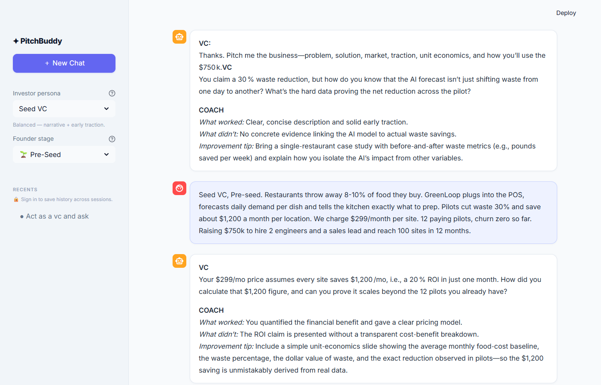
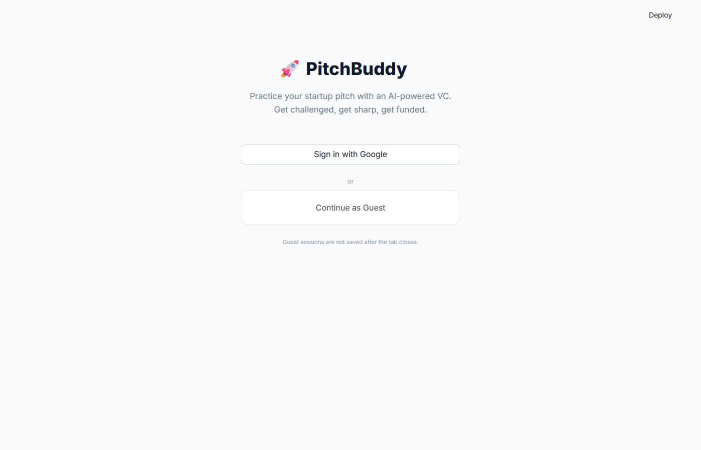
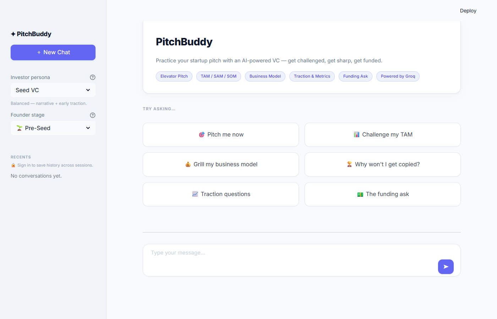
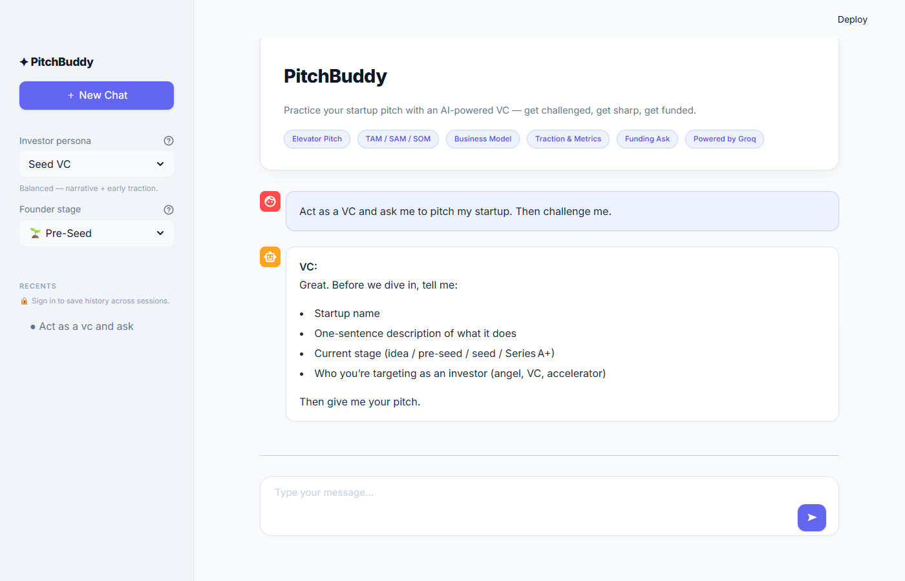
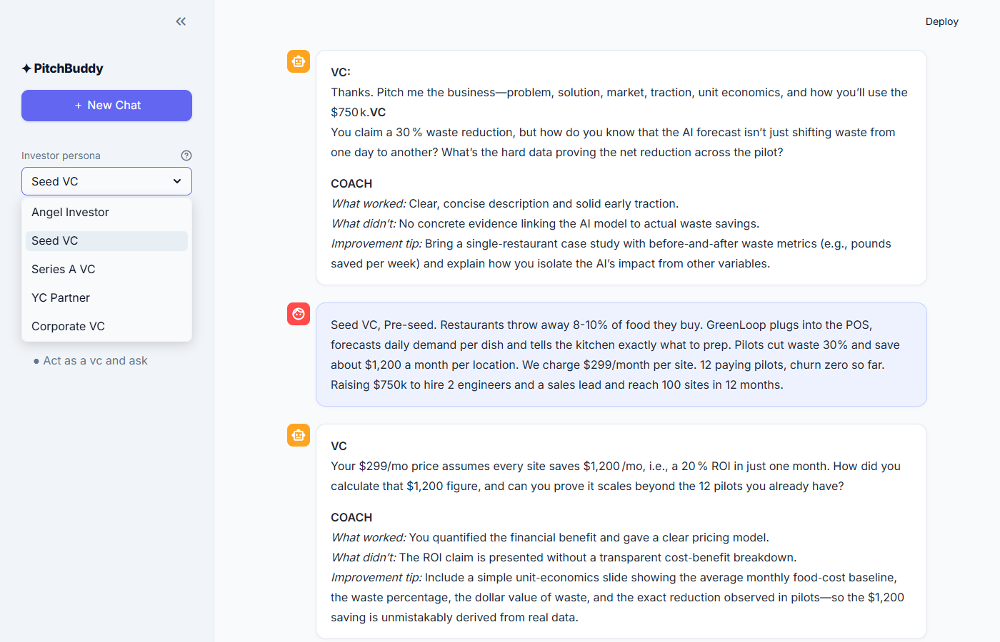
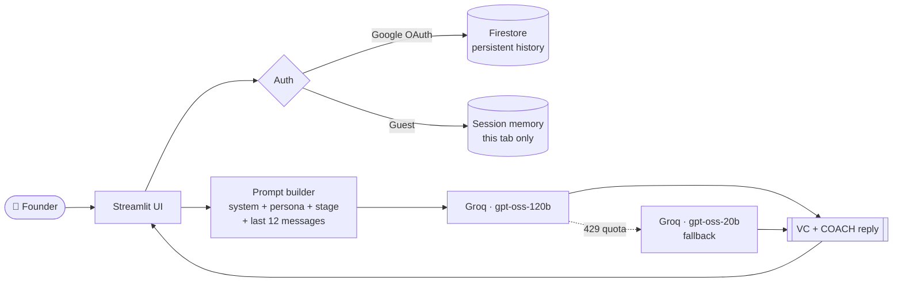

<div align="center">

# 🚀 PitchBuddy

### Pitch to a skeptical AI investor. Get coached on every answer.

Practice your startup pitch against an AI VC that goes straight for your weakest assumption,<br>
and a coach that tells you how to answer it better before the real meeting.

<br>

[](https://pitchbudddy.streamlit.app/)

<br>


<br>



</div>

---

## ✨ What it does

Every AI reply has **two voices**:

<table>
<tr>
<td width="50%" valign="top">

### 🎯 [VC]
Asks **one sharp, skeptical question** aimed at the weakest part of your pitch: TAM, unit economics, defensibility, traction or the raise.

</td>
<td width="50%" valign="top">

### 🧑‍🏫 [COACH]
Tells you **what worked**, **what didn't**, and gives **one concrete fix** you can use in your next answer.

</td>
</tr>
</table>

You set the difficulty by picking who you're pitching to and how far along you are:

| 👤 Investor persona | Style |
|---|---|
| **Angel Investor** | Friendly, story-driven, bets on founders |
| **Seed VC** | Balanced: narrative plus early traction |
| **Series A VC** | Data-driven, expects strong metrics |
| **YC Partner** | Direct, fast, growth-obsessed |
| **Corporate VC** | Focused on strategic fit and partnerships |

**Founder stage:** 💡 Idea → 🌱 Pre-Seed → 🚀 Seed → 📈 Series A+. The further along you are, the harder the VC pushes.

---

## 🖼️ Screenshots

<table>
<tr>
<td width="50%"><br><sub><b>1. Sign in with Google, or continue as a guest</b></sub></td>
<td width="50%"><br><sub><b>2. Pick a persona and stage, then use a one-click prompt</b></sub></td>
</tr>
<tr>
<td width="50%"><br><sub><b>3. The VC asks for the basics</b></sub></td>
<td width="50%"><br><sub><b>4. Switch investor persona at any time</b></sub></td>
</tr>
</table>

👉 A step-by-step walkthrough is in **[flow.md](flow.md)**.

---

## 🌟 Features

- **🎭 5 investor personas × 4 founder stages**: 20 different ways to be grilled
- **⚡ Fast replies** from Groq's inference API
- **🔐 Google Sign-In or Guest mode**: try it with no account, or sign in to keep your history
- **💾 Saved conversations** in Firestore for signed-in users, restored with the persona and stage you used
- **🃏 One-click prompts**: *Pitch me now*, *Challenge my TAM*, *Grill my business model*, *Why won't I get copied?* and more
- **🛡️ Limits that keep it free**: a fallback model, a token cap, a history window and a per-session message limit stop a public demo from burning through the free quota
- **☕ Keep-alive**: a GitHub Action stops the free Streamlit Cloud app from going to sleep

---

## 🏗️ How it works



| Layer | Tech |
|---|---|
| UI | Streamlit + custom CSS |
| LLM | Groq `openai/gpt-oss-120b`, falling back to `openai/gpt-oss-20b`, via LangChain |
| Auth | Google OAuth 2.0 (Authlib redirect flow) or Guest UUID |
| Storage | Firebase Firestore (signed-in users) / in-memory (guests) |
| Resilience | Tenacity retries + model fallback on rate limits |
| Hosting | Streamlit Community Cloud (free) |

---

## 🚀 Quick start

```bash
git clone https://github.com/gmMustafa/PitchBuddy.git
cd PitchBuddy

python -m venv .venv
source .venv/bin/activate          # Windows: .venv\Scripts\activate
pip install -r requirements.txt

cp .env.example .env               # add your free GROQ_API_KEY
streamlit run app.py
```

Open **http://localhost:8501** and click **Continue as Guest**. A free [Groq API key](https://console.groq.com/keys) is all you need.

<details>
<summary><b>🔐 Optional: Google Sign-In and saved history</b></summary>

<br>

1. Put your Firebase service-account key at `firebase-credentials.json` (it's gitignored).
2. Create a Google OAuth client (*Web application*) and add `http://localhost:8501` as an authorised redirect URI.
3. Fill in `GOOGLE_CLIENT_ID`, `GOOGLE_CLIENT_SECRET` and `OAUTH_REDIRECT_URI` in `.env`.

</details>

<details>
<summary><b>☁️ Deploy your own copy on Streamlit Community Cloud</b></summary>

<br>

1. Fork this repo, then go to [share.streamlit.io](https://share.streamlit.io) → **Create app** → main file `app.py`, Python 3.11.
2. Paste your secrets in TOML format (template: [`.streamlit/secrets.toml.example`](.streamlit/secrets.toml.example)).
3. Add your `https://<app>.streamlit.app` URL to the Google OAuth redirect URIs.
4. Set the `APP_URL` repo variable to turn on the [keep-alive workflow](.github/workflows/keep-alive.yml).

Full guide: **[flow.md → Deploy](flow.md#4-deploy-publicly-on-streamlit-community-cloud-free)**

</details>

<details>
<summary><b>⚙️ Configuration</b></summary>

<br>

| Key | Default | Purpose |
|---|---|---|
| `GROQ_API_KEY` | — | **Required** |
| `GROQ_MODEL` | `openai/gpt-oss-120b` | Main model |
| `GROQ_FALLBACK_MODEL` | `openai/gpt-oss-20b` | Used when the main model returns 429 |
| `MAX_RESPONSE_TOKENS` | `900` | Max tokens per reply |
| `MAX_HISTORY_MESSAGES` | `12` | Number of past messages sent to the model |
| `MAX_MESSAGES_PER_SESSION` | `40` | Messages allowed per visitor session |
| `GOOGLE_CLIENT_ID` / `_SECRET` / `OAUTH_REDIRECT_URI` | — | Google Sign-In |
| `[firebase]` table or `FIREBASE_CREDENTIALS` | — | Firestore history |

Values are read from environment variables / `.env` first, then from `st.secrets`.

</details>

---

## 📁 Project structure

```
PitchBuddy/
├── app.py                  # Entry point: layout and routing
├── flow.md                 # Walkthrough, setup and deployment guide
├── src/
│   ├── config.py           # Prompts, personas, stages, free-tier limits
│   ├── ai/
│   │   ├── agent.py        # Prompt assembly + model fallback
│   │   └── clients.py      # Cached Groq clients
│   ├── db/
│   │   ├── store.py        # Picks Firestore or session storage
│   │   ├── firestore.py    # Signed-in user history
│   │   └── session_store.py# Guest history (in-memory)
│   ├── ui/                 # auth, sidebar, chat, input bar, session, styles
│   └── utils/retry.py      # Retry and rate-limit detection
├── docs/screenshots/
└── .github/workflows/keep-alive.yml
```

---

<div align="center">

**Built by [Ghulam Mustafa](https://github.com/gmMustafa)** · MIT License

If PitchBuddy helped you sharpen your pitch, please give it a ⭐

</div>
