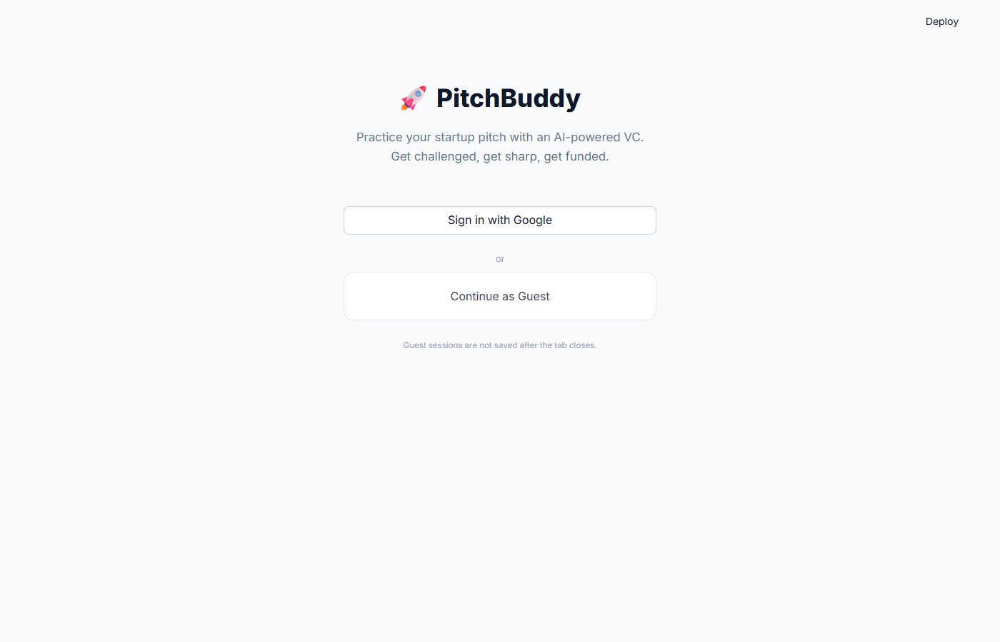
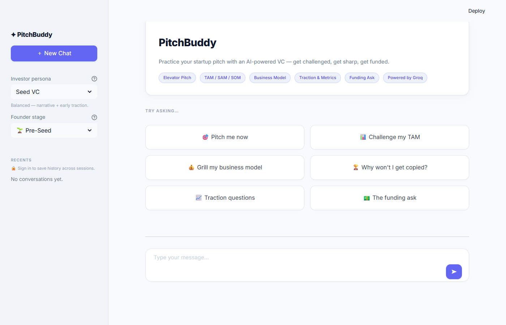
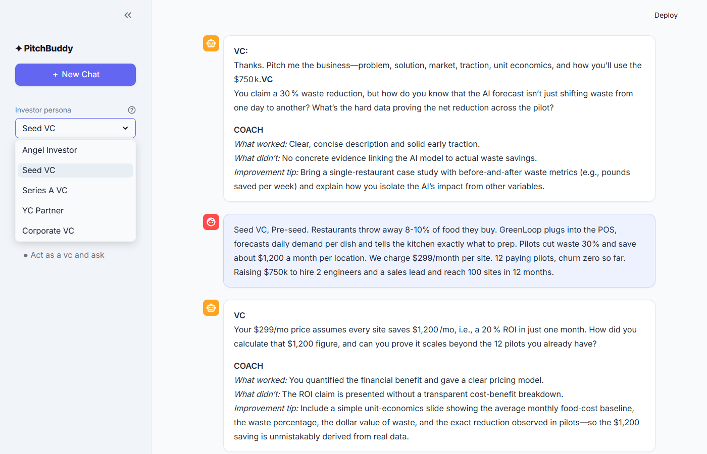
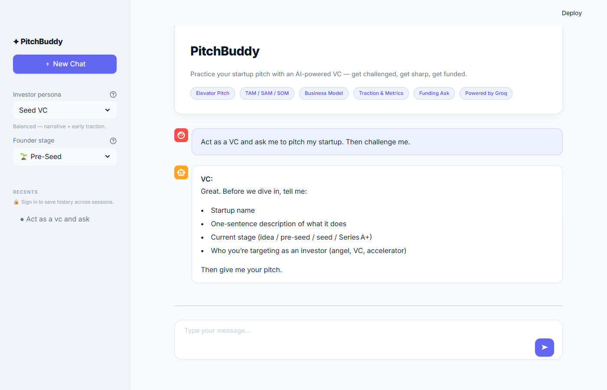
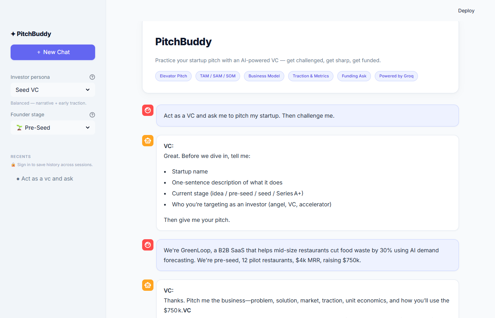
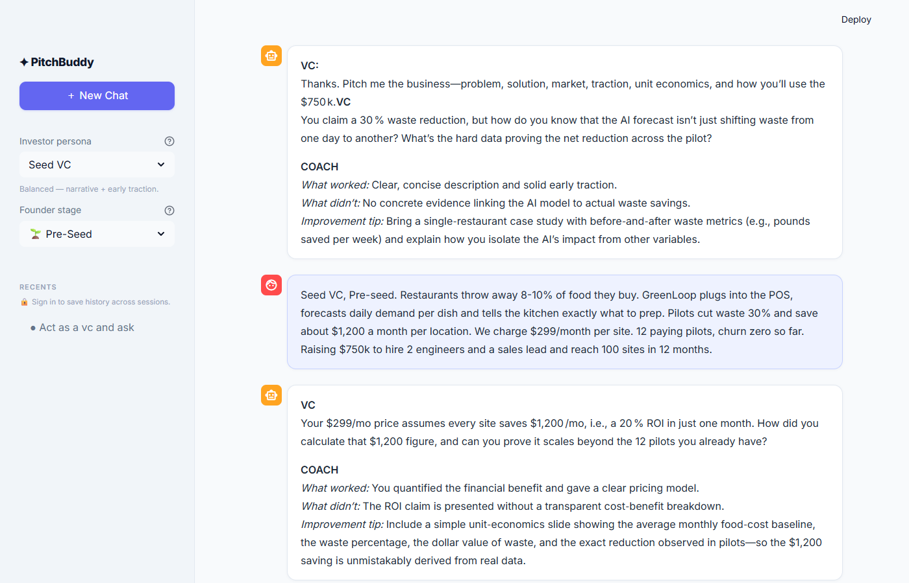

# PitchBuddy — App Flow, Local Setup & Deployment

PitchBuddy is an AI pitch-practice app. You pitch your startup, and an AI plays two roles in each reply:

- **[VC]** asks one sharp, skeptical question aimed at the weakest part of your pitch.
- **[COACH]** tells you what worked, what didn't, and gives one concrete improvement.

You choose an **investor persona** (Angel, Seed VC, Series A VC, YC Partner, Corporate VC) and a **founder stage** (Idea → Series A+). Both change how hard the AI pushes and what it focuses on.

---

## 1. User flow (with screenshots)

### Step 1 — Landing page
Choose **Sign in with Google** (history saved in Firestore across visits) or **Continue as Guest** (history kept only in this browser tab, no account needed).



### Step 2 — Set up the session
The sidebar holds **New Chat**, the **Investor persona** and **Founder stage** pickers, and **Recents** (your past conversations). The main area shows one-click suggestion cards: *Pitch me now*, *Challenge my TAM*, *Grill my business model*, *Why won't I get copied?*, *Traction questions*, *The funding ask*.



Each persona has its own personality:



### Step 3 — The VC opens
Click a card or type a message. The VC first collects the basics: startup name, one-line description, stage and target investor.



### Step 4 — Pitch and get grilled + coached
From here on, every reply has a **[VC]** question and a **[COACH]** block. Keep answering to tighten the pitch. The conversation shows up under **Recents**.





---

## 2. How it works

```
Browser ──▶ Streamlit app (app.py)
              │
              ├─ src/ui/auth.py      Google OAuth (authlib redirect) or Guest UUID
              ├─ src/ui/sidebar.py   persona / stage / recents
              ├─ src/ui/session.py   message handling + per-session limit
              │
              ├─ src/ai/agent.py     system prompt + persona + stage + last 12 messages
              │      └─ src/ai/clients.py  Groq: gpt-oss-120b → fallback gpt-oss-20b
              │
              └─ src/db/store.py     router
                     ├─ firestore.py      signed-in users (persistent)
                     └─ session_store.py  guests (in-memory, per tab)
```

On each message:
1. `session.py` checks the per-session message cap, then saves the user message.
2. `agent.py` builds the prompt: base system prompt + persona instructions + stage + the last `MAX_HISTORY_MESSAGES` turns.
3. Groq `openai/gpt-oss-120b` answers. If its free quota is used up (HTTP 429), the app retries on `openai/gpt-oss-20b`.
4. The reply is saved and shown. Any error appears as a friendly warning, not a stack trace.

---

## 3. Run it locally

**Requirements:** Python 3.11+ and a free Groq API key from <https://console.groq.com/keys>.

```bash
git clone <your-repo-url> PitchBuddy
cd PitchBuddy

python -m venv .venv
# Windows:  .venv\Scripts\activate
# mac/Linux: source .venv/bin/activate

pip install -r requirements.txt

cp .env.example .env          # then put your GROQ_API_KEY in .env
streamlit run app.py
```

Open <http://localhost:8501> and click **Continue as Guest**. Guest mode needs only `GROQ_API_KEY`.

**Optional — Google Sign-In + saved history:**
- Put the Firebase service-account file at `firebase-credentials.json` (gitignored).
- Create an OAuth client (type *Web application*) in Google Cloud Console → APIs & Services → Credentials. Add `http://localhost:8501` as an authorised redirect URI, and put the client ID/secret in `.env`.

**Windows + antivirus with HTTPS scanning (Avast/AVG/Kaspersky):** if you see `Connection error` or `CERTIFICATE_VERIFY_FAILED`, the antivirus is re-signing TLS traffic. Either turn off its HTTPS scanning for Python, or export the Windows root certificates to a bundle and point Python at it:

```bash
python -c "import ssl,certifi;open('winroots.pem','w').write(open(certifi.where()).read()+''.join(ssl.DER_cert_to_PEM_cert(c) for s in ('ROOT','CA') for c,e,_ in ssl.enum_certificates(s) if e=='x509_asn'))"
set SSL_CERT_FILE=%CD%\winroots.pem
set GRPC_DEFAULT_SSL_ROOTS_FILE_PATH=%CD%\winroots.pem
streamlit run app.py
```

---

## 4. Deploy publicly on Streamlit Community Cloud (free)

Streamlit Community Cloud runs this app with no code changes: entry file `app.py`, dependencies in `requirements.txt`, config in `.streamlit/config.toml`.

1. **Push the repo to GitHub.** The repo can be public or private, but secrets must never be committed (`.env`, `firebase-credentials.json` and `.streamlit/secrets.toml` are already gitignored).
2. Go to <https://share.streamlit.io> → **Create app** → choose the repo, branch `main`, main file `app.py`.
3. Under **Advanced settings**, set Python to **3.11** and paste your secrets in TOML format (template: `.streamlit/secrets.toml.example`). To convert the Firebase JSON into the `[firebase]` table:
   ```bash
   python -c "import json;d=json.load(open('firebase-credentials.json'));print('[firebase]');[print(f'{k} = {json.dumps(v)}') for k,v in d.items()]"
   ```
4. Choose a custom subdomain, e.g. `pitchbuddy.streamlit.app`, and **Deploy**.
5. **Google Sign-In:** in Google Cloud Console, add `https://pitchbuddy.streamlit.app` to the OAuth client's authorised redirect URIs, and set `OAUTH_REDIRECT_URI` to that URL in the app's secrets. Guest mode works without this step.
6. If the OAuth consent screen is in *Testing* mode, only listed test users can sign in. Click **Publish app** to allow anyone.

### Keeping it awake
Community Cloud puts apps to sleep after about 12 hours with no visitors. The next visitor then has to click "wake up" and wait a minute or so. `.github/workflows/keep-alive.yml` opens the app in a headless browser every 6 hours and clicks the wake button if needed. To turn it on: GitHub repo → **Settings → Secrets and variables → Actions → Variables** → add `APP_URL` = your app URL. You can also run it by hand from the **Actions** tab.

---

## 5. Keeping API usage free on a public app

Everyone who visits the public app uses **your** single Groq key, so the app limits how much each visitor can spend:

| Guard | Default | Where | Why |
|---|---|---|---|
| Primary model | `openai/gpt-oss-120b` | `GROQ_MODEL` | Best free Groq model for this task |
| Fallback on 429 | `openai/gpt-oss-20b` | `GROQ_FALLBACK_MODEL` | Has its own quota, so the app keeps answering when the main model's quota is used up |
| Reply cap | 900 tokens (incl. reasoning) | `MAX_RESPONSE_TOKENS` | Replies are short by design; stops runaway output |
| Reasoning effort | `low` | `clients.py` | Fewer hidden reasoning tokens per reply |
| History window | last 12 messages | `MAX_HISTORY_MESSAGES` | Keeps input tokens flat as chats get longer |
| Session cap | 40 messages | `MAX_MESSAGES_PER_SESSION` | Stops one visitor or bot from using up the daily quota |
| Graceful 429 | warning banner | `session.py` | Visitors see "busy, try again in a minute" instead of a crash |

All guards can be changed in the Streamlit secrets without touching code.

**Other free-tier limits to watch:**
- **Groq:** free tier, no credit card. Per-model RPM/RPD/TPM limits are listed at <https://console.groq.com/settings/limits>. Without a payment method, going over a limit returns a 429; it never creates a bill.
- **Firebase Firestore (Spark plan):** free daily read/write quota. Only signed-in users write to Firestore; guests stay in memory. Staying on Spark (no billing account) means you can't be charged.
- **Streamlit Community Cloud:** free, about 1 GB RAM per app, and the app sleeps when idle (see above).

**If traffic grows:** lower `MAX_MESSAGES_PER_SESSION`, require Google sign-in (remove the guest button), or add a "bring your own Groq key" field.

---

## 6. Configuration reference

| Key | Required | Notes |
|---|---|---|
| `GROQ_API_KEY` | yes | Groq console |
| `GOOGLE_CLIENT_ID` / `GOOGLE_CLIENT_SECRET` | for sign-in | Google Cloud OAuth client |
| `OAUTH_REDIRECT_URI` | for sign-in | Must exactly match an authorised redirect URI |
| `[firebase]` table **or** `FIREBASE_CREDENTIALS_JSON` **or** `FIREBASE_CREDENTIALS` (file path) | for sign-in history | Checked in that order |
| `GROQ_MODEL`, `GROQ_FALLBACK_MODEL`, `MAX_*` | no | Free-tier guards, see §5 |

Values are read from environment variables / `.env` first, then from `st.secrets`.
